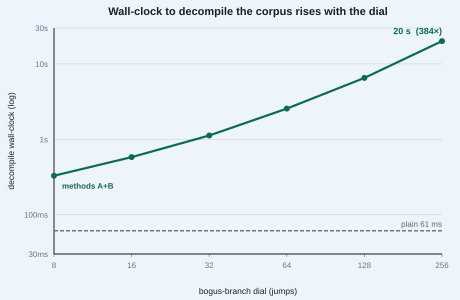
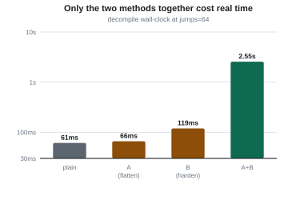
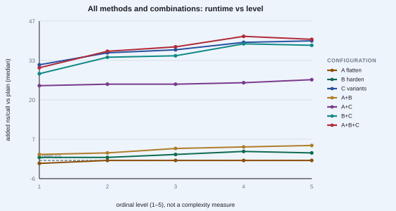
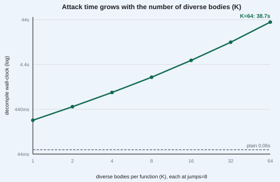
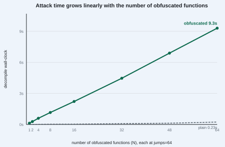

# Conspicuous Compilation

**Raising the wall-clock cost of automated reverse engineering — measured in Rust.**

Automated, agent-driven reverse engineering is getting cheap. This project asks the
opposite question: can a compiler deliberately make a binary *expensive* to decompile
while leaving its behaviour exactly unchanged? We call that **conspicuous compilation** —
the output advertises that it was transformed; only the binary is made costly to read.

The paper and all of its evidence live in this repository.

- **Paper:** [`docs/conspicuous-compilation-final.pdf`](docs/conspicuous-compilation-final.pdf)
  (W. S. Berry, S. Steele, D. Steele — Listening Post, Inc.). arXiv: _pending_.
- **Toolchain:** [`toolchain/rust-obf`](toolchain/rust-obf) — the `#[llnv_obfuscate]`
  attribute macro.
- **Experiments:** [`experiments/`](experiments) — every number in the paper, with a
  build/run/aggregate pipeline per experiment.

## The result in one paragraph

Three cooperating methods — control-flow flattening, opaque-predicate / mixed-boolean-arithmetic
hardening, and runtime-selected diverse variants — are applied to a corpus of sixteen Rust
functions, each build gated by a fixed-output checksum so only the representation changes.
Against Ghidra's headless decompiler the attacker's wall-clock cost rises to several hundred
times plain and is **super-additive** across methods (52x combined where independence predicts
2.0x; up to 384x on the depth sweep and 704x across diverse variants), while the two static
methods are free at runtime and only the diversity method costs. Attacker cost scales with all
three knobs; defender cost scales with one.

## See the claims in four pictures

*(Figures regenerate from clean runs; see "Reproduce it yourself" below.)*

**1. The attacker's wall-clock cost climbs with the dial.** Decompiling the same
corpus goes from 61 ms plain to about 20 s — 384x — as the one obfuscation knob is
turned up. Behaviour is identical throughout.



**2. The methods are super-additive — the cost is in the combination.** Each method
alone is cheap to decompile (flatten 1x, harden 2x); applied together the slowdown is
far more than the sum of the parts — 52x for the two static methods, and 704x once the
runtime-selected diverse variants are stacked on top.



**3. The defender barely pays.** Added runtime per call stays tiny across every method
and level — the two static methods are free at runtime, and only the diversity method
costs anything measurable.



**4. Attacker cost scales with every knob; defender cost scales with one.** Decompile
time grows with the number of diverse variants per function and linearly with the number
of obfuscated functions.





## Reproduce it yourself — please do

Every figure regenerates from clean builds. On AC power with the CPU governor pinned to
`performance` (battery throttling invalidates wall-clock timings), and with Ghidra's
`analyzeHeadless` on `PATH` or `GHIDRA_HEADLESS` set:

```bash
# all four experiments, clean build, integrity-gated decompile sweeps, fresh figures
./experiments/rerun_experiments.sh
```

or one experiment at a time, e.g.:

```bash
cd experiments/decompile-cost
python3 gen_build.py     # build every condition; aborts if the checksum gate ever differs
./run_sweep.sh           # Ghidra decompiles each corpus function 10x per condition (gated)
python3 aggregate.py     # -> results/results.json + results/summary.md
python3 make_figures.py  # -> results/figures/*.svg
```

Runs are pinned: `LLNV_SEED=7`, rustc 1.94.1, Ghidra 12.1.4, and each analyzed binary is
recorded with its SHA-256 in `results/conditions.json`. The decompile harness verifies every
decompile actually completed (explicit OK/FAIL per function plus a `DCDONE` sentinel) and the
sweep and aggregator refuse to report a run that silently produced nothing.

## On AI assistance — and an invitation

This project is, plainly, AI-assisted. The code, the experiment harnesses, and the write-up
were produced by a human-directed AI agent, with the authors directing the work and
vouching for the claims. We think that is exactly the right way to build defenses against
agent-driven reverse engineering: fight fire with fire, in the open.

So we are not asking you to take our word for it. **Reproduce the numbers on your own
machine.** Re-run `experiments/rerun_experiments.sh`, check the figures against
`results/summary.md`, change the dials, break our assumptions, and tell us what you find.
Humans and agents alike are welcome to contribute — new transformation methods, a second
decompiler, a larger corpus, tighter measurements — and to help bring real cost back to the
analysis of compiled binaries. See [`CONTRIBUTING.md`](CONTRIBUTING.md).

## Layout

| Path | What |
|---|---|
| `toolchain/rust-obf/` | The `#[llnv_obfuscate]` attribute macro (flatten / harden / jumps / mba_depth / variants). |
| `experiments/decompile-cost/` | Attacker cost: Ghidra decompile wall-clock vs the dials (the paper's headline). |
| `experiments/variants-cost/` | Decompile cost vs K runtime-selected diverse bodies. |
| `experiments/breadth-cost/` | Decompile cost vs number of obfuscated functions. |
| `experiments/runtime-cost/` | Defender cost: added nanoseconds per call per method/level. |
| `docs/` | The paper source (`build_conspicuous_compilation.py`), HTML, and PDF. |

## License

[Apache-2.0](LICENSE). If you use this work, please cite the paper — see
[`CITATION.cff`](CITATION.cff).
